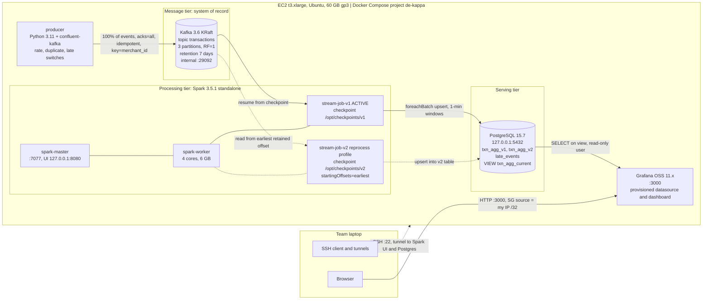

# kappa Payments Pipeline: Phase 1 Design

**Option B: Kappa Architecture** | Kafka (KRaft) + Spark Structured Streaming + PostgreSQL + Grafana
**Team:** `PARINEETA JAIN`, `AMAN PRAKASH` | **Phase 1 due:** 30/10/2026 | **Phase 2 due:** 20/11/2026

> Status: Phase 1 (design only). No implementation code yet. Numbers marked *(assumption)* will be replaced by measured values in Phase 2.

---

## 1. Domain and data contract

**Domain:** card payment transactions. Entity key = `merchant_id`.

| Field | Type | Purpose |
|---|---|---|
| `event_id` | UUID string | Unique ID. Used for de-duplication |
| `event_time` | ISO-8601 UTC, millisecond precision | When the payment happened. Drives event-time windows |
| `merchant_id` | string (e.g. `m_0001`..`m_0050`) | Entity key and Kafka partition key |
| `user_id` | string | Secondary attribute |
| `amount` | decimal(12,2) | Numeric measure |
| `currency` | string | Attribute |
| `status` | `approved` / `declined` | Attribute, used for approval-rate chart |

Average serialized size is about 200 B of JSON, rounded up to **300 B per record** *(assumption)* to include Kafka record and batch overhead.

**Generator switches (Phase 2):** `--rate` (events/s, default 100), `--dup-pct` (re-emit a copy of already-sent events), `--late-pct` / `--late-max-sec` (delay `event_time` relative to send time), `--very-late-pct` (beyond the watermark, used to demonstrate dropped events), `--out-of-order` (shuffle within a small buffer).

---

## 2. Architecture diagram



### Ports and exposure

| Port | Service | Binding | In Security Group? |
|---|---|---|---|
| 22 | SSH | host | **Yes, my public IP /32 only** |
| 3000 | Grafana | host | **Yes, my public IP /32 only** |
| 9092 | Kafka EXTERNAL listener | `127.0.0.1` | No. The producer runs inside Compose and uses `kafka:29092` |
| 29092 / 29093 | Kafka INTERNAL / CONTROLLER | Compose network only | No |
| 5432 | PostgreSQL | `127.0.0.1` | No (SSH tunnel) |
| 7077, 8080, 8081 | Spark master, master UI, worker UI | Compose network or `127.0.0.1` | No (SSH tunnel) |

Tunnel example: `ssh -i key.pem -L 8080:localhost:8080 -L 5432:localhost:5432 ubuntu@<ELASTIC_IP>`

**Deviations from the Appendix A reference stack** (each justified in the TDR below): Superset replaced by Grafana; Kafka external listener bound to loopback; Spark worker raised from 2 to 4 cores; per-app core cap so two jobs can run at once; added `segment.ms` to the topic; added a `reprocess` Compose profile with a second stream job.

---

## 3. Technology Decision Record

### 3.1 Language
- **Decision:** Python 3.11 (PySpark for the job, `confluent-kafka` for the producer) plus plain SQL for serving objects.
- **Alternatives:** Scala/Java (Flink or Kafka Streams), SQL-only (ksqlDB).
- **Why:** The reference stack and staff support are PySpark-based. Both team members already know Python. SQL covers the view, cut-over and validation queries.
- **Trade-off:** PySpark has JVM/Python serialization overhead. At 100 events/s this is irrelevant.

### 3.2 Message log / broker
- **Decision:** Apache Kafka in KRaft mode (`confluentinc/cp-kafka:7.6.1`, Kafka 3.6), single node, topic `transactions` with 3 partitions, RF=1.
- **Alternatives:** Redpanda (lighter, Kafka API), Apache Pulsar (heavier).
- **Why:** Meets the Kappa log requirements: durable, ordered per partition, replayable from the earliest offset, with time-based retention. KRaft removes ZooKeeper, saving RAM. It is the best-documented option, and the reference compose file already configures it.
- **Topic config:** `retention.ms=604800000` (7 d), `retention.bytes=-1` (no size-based truncation), `segment.ms=3600000` (see 4.1 for why), `cleanup.policy=delete` (never `compact`, since we need every event).
- **Producer config:** `acks=all`, `enable.idempotence=true`, key = `merchant_id` (per-merchant ordering).
- **Risks:** RF=1 means a disk loss loses the log. This is accepted for a single-instance course project and stated in the README. Retention is deletion-based, so replay only works inside the 7-day window.

### 3.3 Stream processing
- **Decision:** Spark Structured Streaming 3.5.1 on a Spark standalone cluster (1 master, 1 worker with 4 cores and 6 GB).
- **Alternatives:** Apache Flink (stronger event-time model), Kafka Streams / ksqlDB (no extra cluster), Faust/Bytewax (smaller ecosystems).
- **Why:** Supports event-time windows, watermarks, `dropDuplicatesWithinWatermark` (3.5+), checkpointed state and Kafka offset recovery. It matches the staff-supported stack. Flink would be a better late-data engine but adds an unfamiliar runtime and no staff support.
- **Key settings:** `startingOffsets=latest` for v1 and `earliest` for v2 (only honored on a fresh checkpoint), `maxOffsetsPerTrigger` capped (keeps replay from creating huge micro-batches that distort watermark behavior), `spark.cores.max=2` per application so **two jobs can run side by side** (without a cap the first app takes all cores and v2 would never start).
- **Risks:** Micro-batch latency (a few seconds). Spark drops too-late events silently, so we add a side channel to count them (4.2).

### 3.4 Batch processing and raw archive
- **Decision:** **None. Not applicable to Kappa.** No S3 path, no batch layer. Kafka is the single system of record, and recomputation is done by replaying the log.

### 3.5 Serving store
- **Decision:** PostgreSQL 15.7.
- **Alternatives:** TimescaleDB, ClickHouse, DuckDB.
- **Why:** Needed features are simple: upsert on a primary key, plain views for atomic cut-over, and a native Grafana datasource. Output volume is tiny (a few thousand window rows per hour). ClickHouse would use more RAM for no benefit at this scale.
- **Design:** one output table per job version (`txn_agg_v1`, `txn_agg_v2`), a stable view `txn_agg_current` that Grafana reads, a `late_events` audit table, and a read-only role `grafana_ro` limited to the view and audit table.

```sql
CREATE TABLE txn_agg_v1 (
  window_start   timestamptz NOT NULL,
  window_end     timestamptz NOT NULL,
  merchant_id    text        NOT NULL,
  txn_count      bigint      NOT NULL,
  approved_count bigint      NOT NULL,
  total_amount   numeric(18,2) NOT NULL,
  updated_at     timestamptz NOT NULL DEFAULT now(),
  PRIMARY KEY (window_start, merchant_id)
);
-- txn_agg_v2 has the identical definition (created before reprocessing)
CREATE VIEW txn_agg_current AS SELECT * FROM txn_agg_v1;

CREATE TABLE late_events (
  event_id text PRIMARY KEY, event_time timestamptz, kafka_ts timestamptz,
  lateness_sec int, merchant_id text, amount numeric(12,2)
);
```

### 3.6 BI and dashboards
- **Decision:** Grafana OSS (pinned image tag, e.g. `grafana/grafana-oss:11.2.0`, to be verified at implementation) with the built-in PostgreSQL datasource.
- **Alternatives:** Superset (reference stack, heavier, needs a custom image), Metabase.
- **Why:** Lightweight (~300 MB RAM), time-series first, **5 s auto-refresh**, and datasource plus dashboards are provisioned from files in the repo, so the dashboard is reproducible and the JSON is the "exported configuration".
- **Planned panels (at least 3, reading `txn_agg_current`):**
  1. Revenue per minute (time series)
  2. Transactions per minute by merchant, top 10 (bar or time series)
  3. Approval rate (stat or gauge)
  4. Freshness: `now() - max(window_end)` (stat)
  5. Dropped late events count and recent rows (stat and table)
  6. v1 vs v2 comparison during reprocessing (time series)
- **Security:** admin password from `.env`, anonymous access off, Security Group restricted to my IP /32.

### 3.7 Deployment
- **Decision:** one Docker Compose project on one EC2 `t3.xlarge` (4 vCPU, 16 GB), Ubuntu, **60 GB gp3** (sizing in 4.1), Elastic IP, all image tags pinned, secrets only in `.env` (git-ignored, `.env.example` committed). No AWS services are used in this option, so no AWS credentials are needed.
- **Estimated memory:** Kafka ~1 GB, Spark worker 6 GB, master + two drivers ~2 GB, Postgres ~0.5 GB, Grafana ~0.3 GB, producer ~0.2 GB. About 10 GB of 16 GB.
- **Budget:** about $0.17/h compute (on-demand, us-east-1, to be checked against the Learner Lab meter). 4-hour sessions on about 20 days is roughly 80 h, around $14. Instance is stopped when not in use.

---

## 4. Kappa design checklist

### 4.1 Log sizing (7-day retention)

Formula: `events/s × avg bytes × 86,400 s × 7 days`, then a margin.

| Rate | Per day | 7 days (raw) | With 1.5× margin |
|---|---|---|---|
| 50 ev/s | 1.30 GB | 9.1 GB | 13.6 GB |
| **100 ev/s (default)** | **2.59 GB** | **18.1 GB** | **27.2 GB** |
| 500 ev/s (stress test) | 12.96 GB | 90.7 GB | 136 GB |

Worked example for 100 ev/s: 100 × 300 B = 30,000 B/s; × 604,800 s = 18.14 GB. Margin (1.5×) covers duplicate injection (~5%), record overhead variance, and segments that outlive retention (below). Compression (`compression.type=lz4`) would typically cut JSON by several times, but is **not** counted in the plan, so compression is a bonus, not a dependency.

**Why `segment.ms` matters:** Kafka only deletes whole *closed* segments. With the default 7-day segment roll, data can live up to ~14 days. Setting `segment.ms=3600000` (1 h) makes actual retention about 7 days plus 1 hour. At 100 ev/s that is about 36 MB per partition per hour, so about 500 segment files across the topic in total, which is fine.

**Disk plan (60 GB):** OS and Docker images ~15 GB, Kafka log ≤ 27 GB, Postgres and checkpoints < 2 GB, remainder is headroom. The 30 GB minimum would be too tight at the default rate, so we provision 60 GB (about $5/month gp3). The v2 reprocessing job re-reads the same log, so it needs **no** extra log storage. If we ever raise the rate toward 500 ev/s, we would lower retention for the stress test only, since 7 days would not fit.

**Phase 2 check:** measure real bytes per event and per-partition size with `kafka-log-dirs` and compare against this estimate.

### 4.2 Late data policy

| Item | Choice | Reason |
|---|---|---|
| Time semantics | **Event time** (`event_time`), not arrival time | Required, and makes replay deterministic |
| Window | **1-minute tumbling**, grouped by `merchant_id` | Fine enough for a live dashboard, small state |
| Watermark | **2 minutes** (`withWatermark("event_time", "2 minutes")`) | Generator's normal late/out-of-order events are delayed up to 90 s. 2 min covers them with margin. A larger value delays finalization and holds more state |
| Output mode | `update` via `foreachBatch`, upsert on `(window_start, merchant_id)` | Dashboard sees provisional values within seconds, and corrections overwrite the same row |
| De-duplication | `dropDuplicatesWithinWatermark(["event_id"])` | Duplicates arriving within the watermark horizon are removed |

**Events later than allowed (older than the watermark):** they are **excluded from windowed aggregates** (Spark drops them). To avoid losing them silently we:
1. Detect them in a side branch (`kafka_timestamp − event_time > 2 min`) and write them to `late_events` for audit and a "dropped late events" panel. This is an approximation of Spark's internal watermark check and is documented as such.
2. Leave them in the Kafka log, so a reprocessing job with a longer watermark can include them later. This is the Kappa answer to late data.

**Known limitation:** a *duplicate* that arrives more than 2 minutes after its first copy is not caught by dedup. The generator's duplicate switch defaults to duplicates within 60 s. This limit is documented and tested.

**Delivery semantics:** idempotent producer (no duplicates from retries) → Kafka log (ordered per partition) → Spark checkpoint (offsets and state, restart resumes where it stopped) → idempotent upsert sink. Because each upsert writes the full current aggregate of a window, a replayed micro-batch overwrites rather than adds, giving effectively-once results in Postgres.

### 4.3 Reprocessing runbook

**Scenario for the demo:** v2 widens the watermark from 2 to 10 minutes (and optionally adds a column), so very late events previously dropped are now counted. Expected difference between v1 and v2 is roughly the events recorded in `late_events`.

Prerequisites: Spark worker has spare cores (`spark.cores.max=2` per app), and the earliest retained offset is still inside the 7-day window.

1. **Create the new output table.**
   `psql` → create `txn_agg_v2` with the same (or new) schema. Grant `SELECT` to `grafana_ro` only on the view, not the tables.
2. **Start the v2 job with its own state.** New code path with `JOB_VERSION=v2`, `CHECKPOINT=/opt/checkpoints/v2` (must not exist beforehand), `OUTPUT_TABLE=txn_agg_v2`, `startingOffsets=earliest`.
   `docker compose --profile reprocess up -d stream-job-v2`
   v1 keeps running and serving the dashboard.
3. **Wait until v2 has caught up.** Compare v2's progress with the log end offsets:
   `docker compose exec kafka kafka-run-class kafka.tools.GetOffsetShell --bootstrap-server kafka:29092 --topic transactions --time -1`
   Caught up = v2's `endOffset` is within ~1,000 records of the log end offsets for 3 consecutive micro-batches, and `max(window_start)` in v2 ≈ v1.
4. **Validate** (only closed windows, e.g. older than the watermark plus a margin):
   ```sql
   -- coverage and totals
   SELECT 'v1' v, count(*) windows, min(window_start) first_w, max(window_start) last_w,
          sum(txn_count) txns, sum(total_amount) amount FROM txn_agg_v1
   UNION ALL
   SELECT 'v2', count(*), min(window_start), max(window_start),
          sum(txn_count), sum(total_amount) FROM txn_agg_v2;

   -- row-level differences on closed windows
   SELECT window_start, merchant_id,
          a.txn_count AS v1_cnt, b.txn_count AS v2_cnt,
          a.total_amount AS v1_amt, b.total_amount AS v2_amt
   FROM txn_agg_v1 a FULL OUTER JOIN txn_agg_v2 b USING (window_start, merchant_id)
   WHERE window_start < now() - interval '15 minutes'
     AND (a.txn_count IS DISTINCT FROM b.txn_count
          OR a.total_amount IS DISTINCT FROM b.total_amount);
   ```
   **Pass criteria:** for a logic-preserving change, zero diffs. For the widened-watermark demo, every diff is a window v2 *gained* events in, and the sum of the extra counts matches `late_events` within the documented approximation.
5. **Cut over atomically.** Consumers read only the view, so nothing else changes:
   ```sql
   BEGIN;
   CREATE OR REPLACE VIEW txn_agg_current AS SELECT * FROM txn_agg_v2;
   COMMIT;
   ```
   Confirm in Grafana (5 s refresh) that panels continue and the values reflect v2. (If v2 adds columns, `CREATE OR REPLACE VIEW` requires the original columns to remain first, so append new columns at the end or drop and recreate the view inside the transaction.)
6. **Grace period and rollback.** Keep v1 running briefly. Rollback is the same statement pointing at `txn_agg_v1`.
7. **Retire v1.** `docker compose stop stream-job-v1`, remove it from the Compose file, delete `/opt/checkpoints/v1`, and later `DROP TABLE txn_agg_v1`. v2 becomes the new "v1" for the next change.

**Replay caveat:** the watermark is driven by event times in the data, so replay is largely deterministic, but a huge micro-batch can contain late events that a smaller batch would have dropped. `maxOffsetsPerTrigger` bounds batch size to keep results consistent.

---

## 5. Planned repository layout

```
.
├── README.md                 # this document (design) + Phase 2 run instructions
├── docker-compose.yml        # pinned images, healthchecks, "reprocess" profile
├── .env.example              # committed.  .env is git-ignored
├── .gitignore                # .env, data/, *.pem
├── producer/                 # Dockerfile, producer.py (rate, dup, late switches)
├── jobs/                     # stream_job.py (parameterized by JOB_VERSION)
├── db/init/                  # 001_schema.sql, 002_roles.sql
├── grafana/provisioning/     # datasources/, dashboards/ (JSON committed)
├── scripts/                  # setup_ec2.sh, reprocess helpers, validation SQL
└── docs/                     # diagram sources, screenshots
```

---

## 6. Phase 1 submission checklist

- [ ] Repo created, link posted on Google Classroom
- [ ] Both members have commits in the history
- [ ] `.gitignore` contains `.env`
- [ ] Architecture diagram renders (GitHub renders Mermaid automatically)
- [ ] Technology Decision Record complete (section 3)
- [ ] Kappa checklist answered: log sizing, late data, reprocessing runbook (section 4)
- [ ] Placeholders filled: team names, any changed assumptions (rate, event size)
